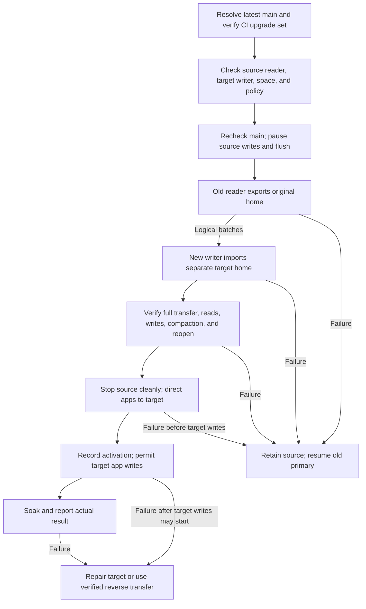

# LastDB upgrade path

Status: proposal for review. This document changes no program, CI gate, cloud policy, or primary data.

Tom selected the migration model: open the old database with the old program and a separate database with the new program.
Transfer the logical data between those programs, verify the result, then direct apps to the new database.
The new program does not need to read the old disk format.

The design uses LastDB source `b94a10a786baa6168a22aa78b2b80c9df7603bbc` and LastStack source `81410faa70fcd7504edb3950c39bca29c3d38a93`.
Later source needs its own compatibility check.

## Initial implementation scope

Tom subsequently requested the live upgrade and migration.
LastDB PR #323 supplies the native record transport and target preparation.
The LastStack change adds the controller route under protocol `9`.
These changes require accepted CI before any primary stop.

The first route supports the current native source and a compatible target reader.
The old engine exports every opaque stored key, value, physical deletion, and mutation version.
The target writer creates independent files and verifies complete record parity.
The route refuses external data files and requires a fresh target after an incomplete transfer.
It does not claim a converter for every retired disk format or a resumable bulk transfer.

The initial controller uses a strict source stop for the whole transfer.
Apps cannot read or write through the primary during that pause.
The old reader and new writer operate on separate stores during the transfer.

For cutover, the controller retains the original stopped data directory by atomic rename.
It then selects the target data at the existing canonical primary path.
The primary home, account identity, app files, supervisor configuration, and public socket path remain in place.
This is the initial alternative to the active-home pointer described below.
The controller must record and verify every old and new data inode before a rename.
After target app writes may start, recovery retains the target and repairs forward.

The sections below retain the broader design, including future complete change-stream and resume support.

## Problem and result

A normal upgrade needs one clear result: the selected main program serves the same data and preserves an effective recovery path.
The old reader owns the old format; the new writer owns the new format.
The plan must establish a complete, supported logical transfer before it pauses primary writes.

The previous upgrade selected `f7e77989a` because its exact program pair passed CI and the compaction checks.
The source check proved that it followed the installed source.
It did not prove that it equaled current main.
Main advanced during preparation, and the process did not report that difference before the upgrade.

Other failures came from separate contracts:

| Observed behavior | Cause | Required change |
| --- | --- | --- |
| A new program refused the old database | The old disk format used an internal journal. The new reader requires an explicit conversion. | Let the old reader export data and the new writer import it into a separate home. |
| Startup refused an old cloud repair file with cloud off | The startup check runs before cloud mode selection. The old external path derives from the home path. | Detect the marker before stop. Give future repair jobs an explicit database identity. |
| The ordinary procedure required retired apps and a cloud backup | The installed procedure described the old route. The accepted native route lived in a separate bundle. | Distribute the program, procedure, graph, and instructions as one verified upgrade set. |
| A saved old program cannot always recover new data | A new writer can advance a record format that the old program refuses. | Retain the old home. Define the recovery boundary before the new database accepts app writes. |

The accepted native route already supplies strict stop, exact program hashes, memory checks, local recovery state, and supervised soak.
Keep those controls and extend the controller for two separate homes.
The current same-home compatibility check does not establish a logical migration path.

## One request, one explicit target

The proposed default is **latest main at the final check before the source write pause**.
An exact revision remains available when the user requests that revision.

1. Resolve current GitHub main to one full source revision.
2. Obtain its CI program pair and its matching upgrade procedure.
3. Require every applicable check, including `benchmark-complete` for LastDB product changes.
4. Validate the exact programs and the source-to-target transfer contract.
5. Read main again immediately before the source write pause.
6. If main changed, prepare the new target and repeat the affected checks.

Permit at most two target refreshes within one request.
Then return `MAIN_CHANGED` and leave the old primary active.
A new main revision with incomplete CI returns `BUILD_PENDING`.
A failed required check returns `REQUIRED_CHECK_FAILED`.
The default never silently selects an older green revision.

After the source write pause starts, finish or recover that exact transaction.
A later merge does not replace the selected files during the transaction.
The final result shows the installed revision and the last observed main revision, with their observation times.
“Latest” refers to that observation; it cannot promise that main stays unchanged.

The user's request can authorize target selection within this policy.
It does not authorize cloud activation, a database reset, an unsupported converter, or a recovery-gap exception.

## One verified upgrade set

CI produces an upgrade set for the selected source and platform.
It contains or references these exact artifacts:

- The CLI and daemon, with versions, hashes, signatures, and architecture.
- The accepted controller, graph, and instructions, with their source and hashes.
- The compatible local formats and required features.
- The record formats and encryption forms that the reader accepts and the writer creates.
- The cloud backup formats and restore capabilities.
- The source exporter, target importer, logical transfer version, and their supported source-to-target pairs.
- The exact migration results and CI artifact identities.

The package manifest and the program's own capability report must agree.
A manifest claim alone does not prove compatibility.
CI must run the actual source reader and target writer on generated data.
The result must include a complete transfer, a resumed transfer, target compaction, and target reopen.

Builds, benchmarks, and latency comparisons run in GitHub Actions.
The upgrade downloads the verified result.
It creates no local build or measurement lock.
CI summaries and retained artifacts supply the validation record; no duplicate routine report enters Git.

The controller can use a verified immutable CI bundle directly.
It need not upgrade unrelated shared tools or promote their channels first.
The normal artifact provenance and trusted graph checks still apply.
There is no replacement preflight that always reports success.

## Check the home without a candidate start

Add an owner-only, read-only compatibility report.
This is proposed product work; no such complete report is assumed today.

The active daemon reports its durable format and feature metadata.
A candidate can compare that metadata with its capabilities before any write access to the primary.
The report must perform no migration, key creation, shutdown-marker removal, repair replay, or cloud request.

The report covers:

| Item | What the plan needs |
| --- | --- |
| Home | Stable database identity, exact path, and active session |
| Disk | Physical format and required feature bits |
| Records | Logical format and encryption forms |
| Transfer | Exact old reader, new writer, logical transfer version, and supported source-to-target pair |
| Recovery | Retained old home, write-pause boundary, and support for a later reverse transfer |
| Cloud | Separate legacy sync, native backup consent, accepted backup scope, and active job state |
| Old repair state | Exact marker presence and ownership classification |
| Process | Supervisor, config digest, current program pair, and memory guard |
| Proof | Generated compatibility coverage for the exact old and new programs |

Read only bounded metadata.
Do not enumerate records or read secret values for this report.
Unknown, unreadable, or contradictory metadata blocks the upgrade before stop.

A generated check proves the selected behavior on generated data.
It does not prove that every primary record is readable.
Use a small approved set of known keys for the actual primary checks.

## Two programs and two database homes

Open the original home through its matching old program.
Create an empty target home and open it through the selected new program.
Give each program a separate socket, process identity, lock, memory limit, and lifecycle owner.
The target accepts migration traffic only until the controller completes the transfer and checks.

The source remains the authority until cutover.
The target can encode data in its own physical and logical formats.
Never open the same writable home through both programs.
Never point the candidate at the source home to discover whether it works.

At the inspected source, main advances the logical record marker from `4` to `5` during construction.
The installed `f7e77989a` reader accepts only `4`.
Under this design, only the new target uses format `5`.
The source remains in format `4`.
This removes the requirement for the old reader to reopen the target.

This proposal requires a separate target database.
Tom's instruction authorizes that design choice; it does not start a live migration in this design pass.
There is no file copy or clone of the primary home, and no candidate node on such a copy.
Do not open or use the retired primary archive.

## A complete logical transfer

Define a versioned local transfer contract independent of either disk format.
The old reader emits logical data; the new writer validates and imports it with durable batch acknowledgements.
The transfer must preserve these facts:

- Database and account identities, schema identities, canonical fields, and key layouts.
- Schema-owned records, named alternate keys, and alternate entries.
- Current values, original write-order facts, tombstones, retained conflicts, and their expiry rules.
- Every required file blob and the encryption material that permits its use.
- App capabilities, grants, and other required durable control data.
- Required file holds and the meaning of pending cloud work.

Import preserves original identities and write-order facts.
Each schema owns its record values.
Preserve canonical field definitions separately from record values.
It does not submit old values as fresh ordinary app writes.
The target reserves fresh write identities beyond the imported boundary before it accepts new app writes.
The target rebuilds its physical storage, counters, and other derived state under the new format's rules.
It does not import obsolete pack bytes, cache contents, host paths, old shutdown state, or opaque repair jobs.
Any unsupported required fact blocks the migration; the importer cannot silently discard it.

The source exporter follows a consistent storage root and its exact key references.
It supplies a complete manifest and explicit end marker for that source boundary.
This requires an internal maintenance interface, not a public query with no key.
An app list, search result, or sample of keys cannot prove completeness.
LastDB still exposes no scan operation.

Use bounded batches, file chunks, memory, and queues.
Reserve space for both homes, required files, target compaction, and recovery before the transfer starts.
Check source and target key access before the source write pause.
Keep schema identities and key layouts unchanged; this is a format migration, not an app schema redesign.
The controller handles job metadata and encrypted frames.
The source and target runtimes perform any required decryption and encryption through the supported key service.
Never write plaintext secret values or transfer bodies to logs, chat, Git, or scratch dumps.

The transfer needs source-version exporters and target-version importers as verified release artifacts.
The inspected code does not establish this complete interface today.
Existing native cloud backup transfers physical files; it does not supply a general logical format converter.

If the old daemon lacks an export interface, a matching offline reader can export the original home after a clean stop.
That reader must obey the source format and normal home ownership rules.
Never run it beside another process that owns the same writable home.
If no supported source reader exists, refuse before the source write pause.

## Consistency, resume, and verification

The initial implementation pauses app writes for the full transfer.
It keeps source reads available where the old daemon supports the export directly.
It does not promise a short write pause for a large database.

1. Block new app writes on the source and drain accepted work.
2. Drain related internal mutations and flush all accepted data.
3. Record one durable source boundary and hold every file that its export needs.
4. Transfer and import that exact boundary in durable batches.
5. Compare source and target completeness facts and logical digests.
6. Check target reads, durable writes, compaction, and a clean reopen on its private socket.
7. Direct apps to the verified target, then permit app writes there.

Reject or delay new app writes explicitly; never acknowledge them without an owner.
The source cannot accept new writes behind the recorded boundary.
Internal work must either respect that boundary or use the supported consistent-root mechanism.

Each transfer batch carries the job, source boundary, sequence, stable item identities, and content digest.
The target acknowledges a batch only after its imported state and resume checkpoint are durable together.
A repeated batch returns the same result; a conflicting repeat fails.
An incomplete frame never advances the checkpoint.
Resume requires the same source boundary, old reader, new writer, transfer contract, and target job.

Verification compares all exported objects and required files, not only record counts.
Source and target compute the same canonical logical digest despite different disk bytes.
The target proves that every required reference resolves and every required file is complete.
The checks include deletion state, schema-owned values, alternate-key membership, record identity, retained conflicts, and app access.
Use migration-owned keys for write checks and exclude those declared checks from the source-to-target digest comparison.
Read migrated values by their exact source keys in batches.
Do not use real secret values as operator-visible examples.

A later optimization can transfer the base while source writes continue.
It requires a consistent base plus a complete ordered change stream, including deletions, from that exact boundary.
Then a final write pause drains the remaining changes before verification.
Do not infer such a stream from ordinary app reads or assume that the current source supplies it.

## Cutover and recovery

Use one durable active-home selection and one stable client route.
The target keeps its private route until verification completes.
Drain old client sessions and require the old supervisor's clean stop before primary ownership moves.
The route change, supervisor selection, and durable controller journal must form one recoverable operation.
Existing fixed home and socket paths need explicit support for this selection; it is proposed product work.
Keep the old home at its original path throughout the recovery window.
Do not rename a live source home or start both nodes as the primary.

Before the new database accepts app writes, recovery returns apps to the retained source and releases its write pause.
The old program reads its own unchanged format.
Target-only verification records do not change source data.
Once source writes resume, that target no longer qualifies for cutover at the old boundary.
A later attempt needs a new complete boundary or a supported complete change stream.

CAUTION: After the target accepts app writes, the retained source lacks those new writes.

Record that target writes may start before the controller enables them.
After that point, never switch to the source merely because its program still starts.
Recovery needs a verified reverse logical transfer with a new write pause, or a repair of the target.
A reverse transfer must preserve every accepted target write and supported new data fact.
If an old writer cannot represent those facts, the controller must repair forward rather than lose data.
The proposal does not claim a universal lossless downgrade.

Keep the old home and program pair until the target checks and recovery window complete.
Cleanup requires its own exact-path ownership and retention check.
Neither a successful health check nor an elapsed timer authorizes source deletion.

## Cloud checks follow the selected policy

Local readability, local program recovery, and cloud recovery are separate results.

| Actual policy | Upgrade behavior |
| --- | --- |
| Cloud off | Keep both nodes off. Transfer locally. Make no cloud request or restore attempt. Retain the source for recovery. |
| Cloud backup enabled | Preserve consent, account scope, and endpoint. Plan the backup boundary and transfer of cloud ownership separately from local format conversion. |
| Legacy repair state or unknown ownership | Return `LEGACY_REPAIR_PRESENT`. Keep the old primary active and require its explicit recovery procedure. |
| Cloud activation requested | Use a separate activation plan. A program upgrade does not supply that consent. |

Native backup consent and legacy cloud sync are separate controls in current main.
The plan must report both.
An old sync status field cannot stand in for native backup acceptance.

The target cannot publish backups, resume sync, or run account jobs during import.
The old node owns cloud work until the controller stops that work at a recorded boundary.
Bind the target to the existing account through the supported identity and key handoff; do not enroll another account.
Keep the source and target process identities distinct while both exist.
Activate cloud work on at most one selected primary.
Pending work needs a defined successor or a supported new backup; never replay opaque old job files into the target.

Cloud-enabled recovery can require an accepted source backup before cutover.
Complete that backup within a bounded deadline before the target accepts app writes.
Never hold a database write gate across a network request.
On failure, retain the source and return the exact incomplete phase.
Cloud-off migration needs no cloud backup or network connection.
The local migration remains independent of cloud transport formats.

Cloud failures must identify the failed operation and format.
A failed network request does not authorize a new restore format, another account, or repair replay.
The generic cloud V2 contract at the inspected source has no active client or service route.
This design does not assume otherwise.

## Repair state belongs to a database identity

Future repair state must bind a stable database ID, account scope, format, and job identity.
A home path is only a location.
Its hash does not distinguish a retained old database from a fresh database at the same path.

Report old markers before stop, including external markers.
Do not read opaque old repair contents, replay them, delete them, or infer that cloud off makes them harmless.
An old marker without adequate identity remains unknown.
Its resolution belongs to a separate authorized recovery action.

## One controller through completion

Use one host upgrade owner and one durable local journal outside LastDB.
Other chats attach to that operation and read its status.
They do not start another installer or maintenance operation.

Retain the old program pair and stage the new pair in a separate managed install.
Bind the job to both homes, exact programs, source boundary, transfer contract, and cloud policy.
Require the source session's clean ledger and successful shutdown flush before its supervisor yields primary ownership.
Ensure that the supervisor and shell-visible CLI resolve the same selected target pair.
Flush file and directory changes before each durable journal phase.

Keep both nodes' combined memory within the host guard.
Preserve the database identity, data, and cloud policy across the selected target.

On the target, batch the exact-key reads.
Check a default durable ack and the completed disk boundary before later value reads or flush.
Check migrated values, a migration-owned value, actual compaction, a later write, and exact values after clean reopen.
Retain the memory guard and required five-minute soak.
Health alone does not establish record correctness.

Never force a stop, guess a recovery root, or reset data after a failure.
A recovery remains a failed upgrade result.
Report the exact incomplete phase if a clean recovery cannot finish.

Reuse a proof only when all of its actual dependencies match.
Separate the candidate's own reopen proof from complete old-to-new transfer proof.
A source, binary, format, recipe, platform, or relevant config change invalidates affected proof.
This permits reuse without treating a different program as checked.

## Delivery order and acceptance

1. Add the read-only capability report and versioned compatibility metadata in LastDB.
2. Define the logical transfer contract and release the supported old-format exporters and new-format importers.
3. Add durable resume, complete manifests, logical digests, and target checks.
4. Add two-home supervision, stable client selection, cloud ownership handoff, and phase-specific recovery.
5. Produce verified upgrade sets and exact source-to-target operational results in CI.
6. Add latest-main selection, final checks, migration control, and typed refusal reasons in LastStack.
7. Update the installed instructions through the accepted artifact path.

These are proposed changes, not completed behavior.
Implementation requires the normal PR review and non-test gates.
No primary upgrade, cloud activation, CI change, or migration forms part of this design pass.

Acceptance covers these conditions:

- Main changes during preparation.
- Required artifacts are absent.
- The home uses an old disk format.
- The target uses a format that the old program cannot read.
- A transfer omits a record, a deletion, a pointer, a retained conflict, or a required file.
- A transfer batch repeats, changes, or stops before its durable acknowledgement.
- Disk or memory lacks space for both nodes and required work.
- An app attempts a write during the source pause or through an old client connection after cutover.
- A target accepts app writes before a later failure.
- Cloud stays off, or an enabled backup lacks the required data.
- An old repair marker exists.
- A stop, route change, or supervisor change fails before completion.

Each case must either complete its supported operational path or stop before an unsafe effect.
Use real program operations and CI artifacts.
Do not add a test suite, fixture harness, local benchmark, or filesystem clone of the primary.

## Source references

- [Accepted native upgrade route](https://github.com/EdgeVector/last-stack/pull/343).
- [Source ancestry check](https://github.com/EdgeVector/last-stack/blob/81410faa70fcd7504edb3950c39bca29c3d38a93/lib/canary-loom/lastdb-candidate-freshness.py).
- [Exact program-pair workflow](https://github.com/EdgeVector/lastdb/blob/b94a10a786baa6168a22aa78b2b80c9df7603bbc/.github/workflows/mini-upgrade-artifact.yml).
- [Current bundle manifest](https://github.com/EdgeVector/lastdb/blob/b94a10a786baa6168a22aa78b2b80c9df7603bbc/scripts/release/package-lastdb-bundle.sh).
- [Old disk-format refusal](https://github.com/EdgeVector/lastdb/blob/b94a10a786baa6168a22aa78b2b80c9df7603bbc/vendor/laststore/src/disk_pack/current.rs).
- [Old cloud repair marker check](https://github.com/EdgeVector/lastdb/blob/b94a10a786baa6168a22aa78b2b80c9df7603bbc/fold_db/crates/core/src/sync/retired_cloud_repair.rs).
- [Startup check order](https://github.com/EdgeVector/lastdb/blob/b94a10a786baa6168a22aa78b2b80c9df7603bbc/lastdb_node/src/host/boot.rs).
- [Installed reader source](https://github.com/EdgeVector/lastdb/tree/f7e77989a050aa490d64231474c6d7df847c24af).
- [Record format transition source](https://github.com/EdgeVector/lastdb/tree/b94a10a786baa6168a22aa78b2b80c9df7603bbc).
- [Native automatic backup policy](https://github.com/EdgeVector/lastdb/blob/b94a10a786baa6168a22aa78b2b80c9df7603bbc/docs/designs/native-cloud-backup-auto-v1.md).
- [Cloud V2 scope](https://github.com/EdgeVector/lastdb/blob/b94a10a786baa6168a22aa78b2b80c9df7603bbc/docs/designs/cloud-byte-transport-v2.md).
- [Current native backup file transfer](https://github.com/EdgeVector/lastdb/blob/b94a10a786baa6168a22aa78b2b80c9df7603bbc/fold_db/crates/core/src/storage/disk_pack/backup_manifest/content.rs).
- [Current native restore format check](https://github.com/EdgeVector/lastdb/blob/b94a10a786baa6168a22aa78b2b80c9df7603bbc/fold_db/crates/core/src/storage/disk_pack/restore.rs).
